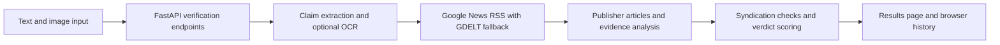

# ClaimCheck AI

ClaimCheck AI checks factual claims submitted as text, an image, or both. It searches news coverage, compares the evidence across publishers, and returns a verdict with source links, excerpts, and a confidence score. The browser stores verification history locally.

## Project structure

```text
main.py              FastAPI routes and verification pipeline
requirements.txt     Python dependencies
frontend/
  index.html         Claim submission
  result.html        Verdict, evidence, and sources
  history.html       Browser-local verification history
  about.html         Application overview
  script.js          Verification requests and page behavior
  style.css          Shared styles
```

## Run locally

Install the Python dependencies from the project folder.

```powershell
python -m pip install -r requirements.txt
```

Start the FastAPI backend in one terminal.

```powershell
python -m uvicorn main:app --host 127.0.0.1 --port 8000
```

Serve the frontend from a second terminal in the same folder.

```powershell
python -m http.server 5500 --bind 127.0.0.1 --directory frontend
```

Open `http://127.0.0.1:5500/`. The interactive API docs are at `http://127.0.0.1:8000/docs`.

- Text verification works with the rule-based engine by default. To enable Claude for claim decomposition, evidence classification, and the written explanation, set `ANTHROPIC_API_KEY` before starting the backend. Set `ANTHROPIC_MODEL` to a model available to your account if needed. A failed Claude call falls back to the rule-based engine.
- To read text from images, install the Tesseract OCR executable separately and make it available on `PATH`. Pillow reads image metadata. Text + Image mode can still check the typed claim if OCR is unavailable.
- The backend needs outbound access to Google News, GDELT, and publisher sites. When Claude is enabled, the backend also sends claims and selected evidence excerpts to Anthropic.

## Architecture

The static frontend in `frontend/` submits claims to the FastAPI application in `main.py`. The app checks up to four subclaims, searches Google News RSS, and tries GDELT when Google fails or returns no results. It deduplicates the source list, resolves publisher links, and extracts evidence from articles or available news snippets.



Syndication checks group repeated coverage to avoid counting copies of the same story as independent corroboration. The verdict can be `TRUE`, `FALSE`, `MIXED`, `RELATED INFORMATION`, or `UNVERIFIED`. The confidence score reflects the evidence the pipeline retrieved and scored. `UNVERIFIED` indicates that the pipeline found insufficient direct evidence.

### Search performance

The backend runs independent news queries and article analysis concurrently in shared pools of four and eight workers, respectively. It merges results in query order before applying the source limit, which defaults to 15. Successful news searches are cached for two minutes, publisher articles for five minutes, and resolved Google News links for 30 minutes. Each backend process has its own bounded caches. Upstream requests use shorter timeouts so slow providers and publishers release workers sooner.

The verification response includes `debug.verification_time_seconds`, `debug.search_time_seconds`, and `debug.source_enrichment_time_seconds`. These show which stage takes the longest for a given claim. Live response times depend on provider availability, publisher access, OCR, and whether Claude is enabled.

## API

| Endpoint | Input |
| --- | --- |
| `POST /verify` | JSON with `claim` and optional `max_sources` (1 to 30) |
| `POST /verify/image` | Multipart upload in the `file` field |
| `POST /verify/multimodal` | `claim` query parameter and optional multipart `file` |
| `GET /health` | Service status and pipeline version |

```powershell
$body = @{ claim = "India landed Chandrayaan-3 on the Moon in 2023"; max_sources = 10 } | ConvertTo-Json
Invoke-RestMethod -Method Post -Uri http://127.0.0.1:8000/verify -ContentType application/json -Body $body
```
